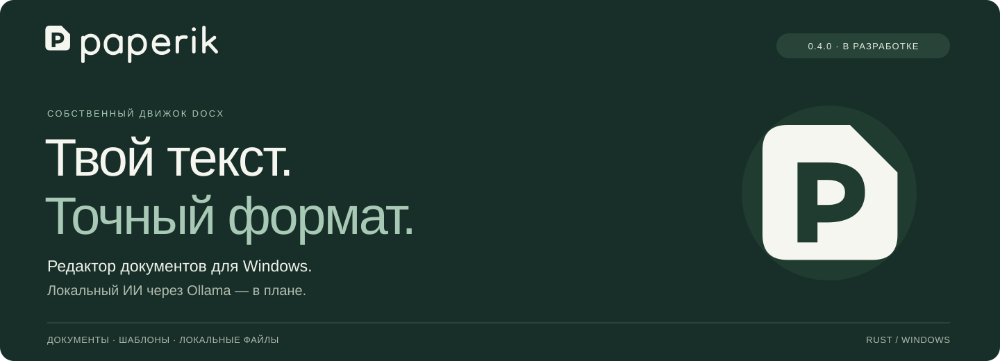
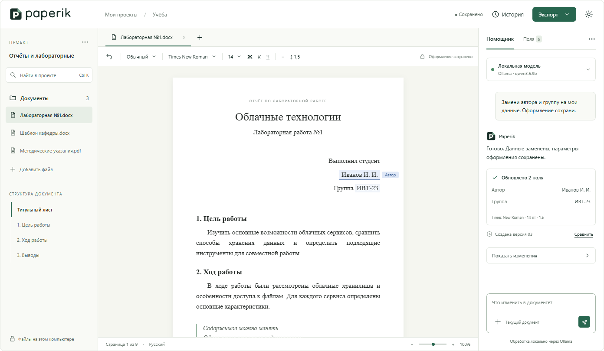

<p align="center">
  
</p>

<p align="center">
  <a href="docs/build.md">Сборка</a> ·
  <a href="docs/fidelity-0.2.1.md">Точность</a> ·
  <a href="docs/brand/README.md">Брендбук</a> ·
  <a href="BACKLOG.md">План разработки</a>
</p>

# Paperik

[](https://github.com/daMpoff/paperik/actions/workflows/windows.yml)

Редактор документов для Windows с собственным движком DOCX. Главный сценарий — взять готовый отчёт, лабораторную или курсовую, заменить содержание и сохранить оформление шаблона: шрифты, интервалы, поля и отступы.

**Paperik 0.6.0.** Редактируются текст, строки и столбцы таблиц, размеры и объединения ячеек. PNG и JPEG можно вставить прямо в текст или ячейку, заменить, удалить и изменить в размере. [Описание релиза](docs/releases/0.6.0.md).

Открытие, вёрстка, сохранение и восстановление выполняются в фоне. Несохранённая сессия остаётся в локальном черновике вместе с курсором и историей Undo/Redo. [Фоновые операции](docs/async-operations.md), [автосохранение](docs/recovery.md).

Справа доступен локальный чат Ollama с выбором модели и потоковым ответом. [Управление чатом](docs/ollama.md).

## Сначала — точный документ

- **Оформление из исходника.** Стили, шрифты, выравнивание, интервалы, поля, базовые списки и нижний колонтитул читаются из DOCX.
- **Собственная вёрстка.** Страницы рассчитывает Paperik; текст измеряется и рисуется через DirectWrite и Direct2D.
- **Удобный просмотр.** Открытие и перетаскивание файлов, переходы по страницам, масштаб, прокрутка, светлая и тёмная темы.
- **Редактирование текста.** Выделение мышью и клавиатурой, ввод, буфер обмена, Undo/Redo и автоматический пересчёт страниц. Соседние фрагменты сохраняют оформление.
- **Сохранение копии.** Текст и оформление проверяются повторным чтением перед записью. При закрытии можно сохранить правки в новый DOCX.
- **Восстановление после сбоя.** Отдельный черновик содержит исходник и историю сессии; при обрыве последнего снимка используется предыдущий исправный.
- **Исходник под защитой.** Существующие файлы не перезаписываются. Отсутствующие шрифты обозначаются явно; обнаруженные неподдерживаемые конструкции могут блокировать открытие или редактирование. Границы обнаружения описаны ниже.

В текущем подмножестве поддерживаются текстовые документы с одним разделом. Подробности — в [описании просмотрщика](docs/docx-viewer.md).

## Точность, которую можно проверить

> **9 страниц · 237 непустых строк · 8186 символов**
>
> Первый шаблон сравнен с PDF из Word: совпали переходы страниц и переносы строк, текст не потерян.

Максимальное отклонение положения символа по горизонтали — **0,454 пт**, базовой линии — **0,140 пт**. Проверка относится к этому шаблону; различия сглаживания остаются. Шрифты и интервалы для подгонки не уменьшались.

[Методика и результаты →](docs/fidelity-0.2.1.md) · [Проверки качества →](docs/testing.md)

## Интерфейс

Файлы слева, документ в центре, помощник справа. Тема меняет оболочку, а оформление документа остаётся таким, как задано в файле.

**Ниже — дизайн-концепция.** Замена полей с ИИ, история и команды редактора на макете показывают целевой сценарий и частично ещё не доступны в версии 0.6.0. Текущее управление описано в [документации редактора](docs/README.md).

<picture>
  <source media="(prefers-color-scheme: dark)" srcset="assets/readme/interface-dark.png">
  
</picture>

Палитра Paper, Ink и Forest, исходные логотипы и правила оформления собраны в [брендбуке](docs/brand/README.md).

## Собрать и запустить

Нужны Windows x64, PowerShell 7 и Rust GNU/LLVM. Установка закреплённого toolchain описана в [инструкции сборки](docs/build.md). Microsoft Build Tools и MSVC для этой сборки не используются.

Release-сборка с проверками, из корня репозитория в PowerShell 7:

```powershell
.\scripts\build.ps1 -Check -Package
```

Архив появится в `dist/paperik-0.6.0-windows-x64.zip`. Распакуйте его целиком и запустите `paperik.exe`.

**Для работы с документами Rust и Ollama не требуются.** Для локального чата нужна отдельно запущенная Ollama с установленной моделью. Автономный запуск проверен на машине разработки; проверка чистой Windows VM остаётся в плане.

`Ctrl+S` — сохранить новую копию · `Ctrl+O` — открыть · `Ctrl+Z / Ctrl+Y` — отмена / повтор · `Ctrl+C / X / V` — буфер обмена · `Shift+стрелки` — выделение · `Ctrl+Home / End` — начало / конец документа.

[Скачать Paperik 0.6.0 →](https://github.com/daMpoff/paperik/releases/tag/v0.6.0) · [Управление и ограничения →](docs/editor.md) · [Автосохранение →](docs/recovery.md)

[Подробная инструкция сборки →](docs/build.md)

## Дальше

- [x] Курсор, выделение, ввод текста, буфер обмена и Undo/Redo в памяти.
- [x] Сохранение новой копии DOCX с прежним оформлением в поддерживаемом подмножестве.
- [x] Локальное автосохранение и восстановление сессии после сбоя.
- [ ] Расширение совместимости DOCX и проверки на дополнительных документах.
- [ ] Ollama: поиск заменяемых полей и команды на естественном языке.
- [ ] Дерево версий, визуальное сравнение и восстановление.
- [ ] Таблицы, изображения, формулы, OCR, источники и совместная работа.

При росте текста допускаются дополнительные страницы. Размер шрифта, интервалы и отступы не уменьшаются автоматически.

Полный перечень задач и критерии готовности — в [backlog](BACKLOG.md).

## Внутри

**Rust · Win32 · DirectWrite · Direct2D · собственные ZIP/OOXML, модель и пагинация.** Базовые библиотеки используются для XML, DEFLATE и системных API; готовые движки редакторов и конвертация через офисные приложения не подключаются.

Сборка проверяется форматированием, Clippy и **63 автоматическими тестами в main**. Есть отдельная диагностика геометрии строк и рендер страниц в PNG.

Локальный чат реализован через Ollama в текущих неопубликованных изменениях; автоматические правки документа ещё впереди. Внешние API планируются по явному выбору пользователя. Возможный сервер на Go рассматривается отдельным этапом. [Архитектура →](docs/architecture.md)

<details>
<summary><strong>Документация и работа над проектом</strong></summary>

- [Требования к продукту](docs/product.md).
- [Этапы разработки](docs/roadmap.md).
- [Архитектура](docs/architecture.md).
- [Поддержка DOCX и ограничения](docs/docx-viewer.md).
- [Редактирование и клавиши](docs/editor.md).
- [Проверка точности первого шаблона](docs/fidelity-0.2.1.md).
- [Тестирование и производительность](docs/testing.md).
- [Технический разбор шаблона](docs/reference-template.md).
- [Реестр решений](docs/decisions/README.md).
- [Правила разработки и русских коммитов](CONTRIBUTING.md).
- [Инструкции для агентов](AGENTS.md).
- [Навигация по документации](docs/README.md).

</details>

## Лицензирование

Лицензия собственных исходников и ресурсов пока не выбрана владельцем проекта. Условия внешних компонентов сохранены в [THIRD_PARTY_NOTICES.md](THIRD_PARTY_NOTICES.md); разбор DOCX, инструментов и распространения — в [docs/legal.md](docs/legal.md).

Системные DLL, файлы шрифтов, Ollama и веса моделей в поставку не включаются.

### Таблицы и рисунки

В версии 0.6.0 редактируются текст, строки и столбцы таблиц, размеры и объединения ячеек. Команды доступны через правый щелчок по ячейке. PNG и JPEG можно вставить прямо в строку текста или ячейку, заменить, удалить и изменить в размере. Правки поддерживают Undo/Redo, восстановление и сохранение копии с оформлением исходного DOCX. Ошибка открытия показывается отдельным диалогом. [Границы поддержки](docs/complex-documents.md).
